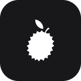
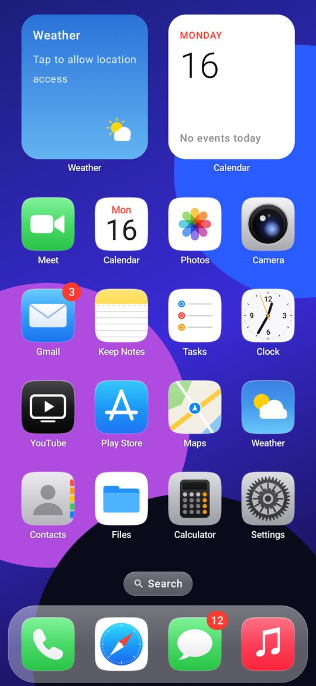
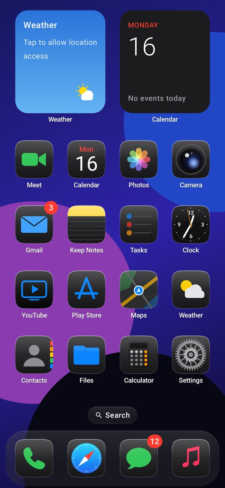
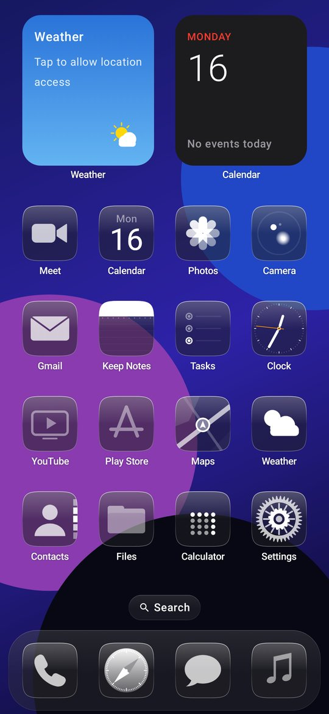
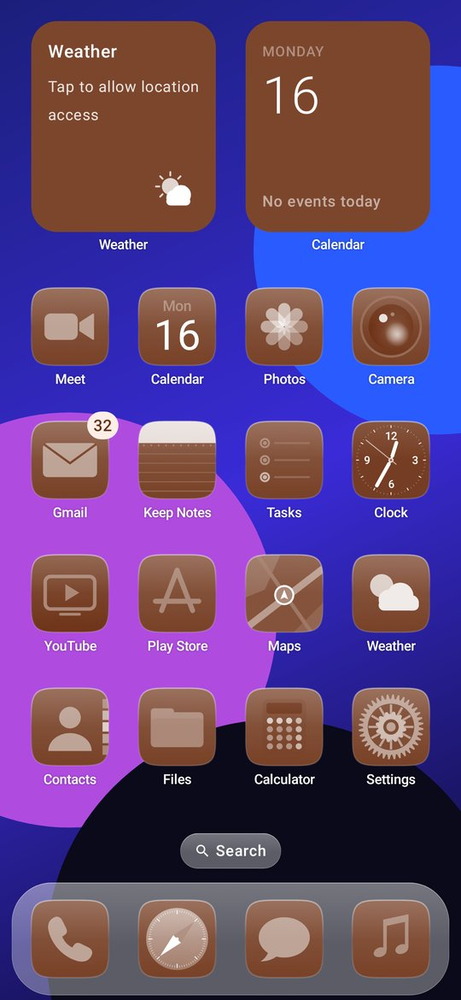
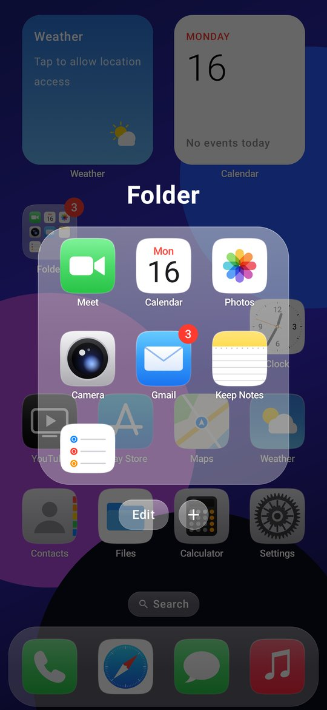
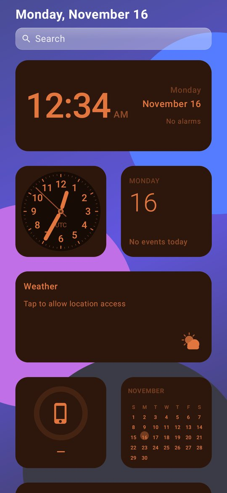

<h1 align="center">DurianOS Home</h1>

<b>iOS experiences in Android with durian scents.</b>

  <a href="https://play.google.com/store/apps/details?id=com.durianos.mufflerexoz">Get it on Google Play</a> ·
  <a href="PRIVACY.md">Privacy Policy</a>

DurianOS Home is a home screen (launcher) for Android with the look and feel of iOS: rounded icons, frosted glass, widgets, folders, an App Library and smooth zoom animations.

| Light | Dark | Clear icons | Tinted icons |
|---|---|---|---|
|  |  |  |  |

## Features
- **iOS-style Home Screen.** Place icons anywhere, drag to rearrange, and hold an app over another to make a folder.
- **Frosted glass** on the dock, folders and search.
- **App Library** groups your apps automatically. You can move apps between categories.
- **Search:** pull down to find any app or search the web.
- **Notification badges** with red counters on app icons.
- **Widget page** to the left of your first Home Screen.
- **Edit Pages:** hide, reorder or delete Home Screen pages.
- **Smooth animations:** apps zoom open from their icon and back again.
- **Backup & restore** your whole Home Screen.

## Free and Pro

|  | Free | Pro (one-time purchase) |
|---|:---:|:---:|
| Home Screen, folders, App Library, search | ✅ | ✅ |
| Notification badges, Edit Name, Edit Pages, backup | ✅ | ✅ |
| Light mode with Default icons | ✅ | ✅ |
| Dark & Auto mode | — | ✅ |
| Dark, Clear (glass) & Tinted icons | — | ✅ |
| All widgets (clocks, calendar, weather, battery, photos…) | — | ✅ |
| Change any app icon (iOS icons, your photos) | — | ✅ |
| Icon packs (Nova / ADW compatible) | — | ✅ |

**Pro is a single payment through Google Play.** There's no subscription, and you can restore it on a new phone with **Restore Purchase**.

| Folders | Widgets |
|---|---|
|  |  |

## Demo video
[Watch: how DurianOS Home uses the installed-apps list (QUERY_ALL_PACKAGES)](video/DurianOS-Home-QUERY_ALL_PACKAGES-demo.mp4) (83 s)

## Privacy
No account, no ads, no tracking. Your layout and settings stay on your phone. See the [Privacy Policy](PRIVACY.md).

## Contact
kulimambangfoto@gmail.com

---
Developer: mufflerexoz
